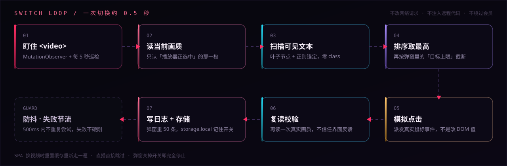
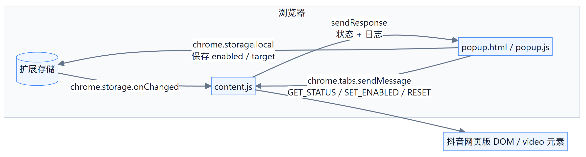

<div align="center">



**打开视频就自动切到当前可用的最高清晰度，不用每次手动点「清晰度」。**

一个基于 Manifest V3、最小权限的 Chrome / Edge 浏览器扩展。

[简体中文](README.md) · [English](README_EN.md)

[](https://github.com/ShirakawaFM/douyin-auto-hd/releases)
[](LICENSE)
[](manifest.json)
[](https://github.com/ShirakawaFM/douyin-auto-hd)
[](https://github.com/ShirakawaFM/douyin-auto-hd)
[](https://github.com/ShirakawaFM/douyin-auto-hd/stargazers)

</div>

> ⚠️ **非官方项目**：与抖音、字节跳动及其关联公司没有任何关系，也未获得其授权。
> 本项目仅用于前端自动化与浏览器扩展技术的学习研究，请自行遵守平台服务条款与当地法律法规。

---

## 目录

- [项目简介](#项目简介)
- [功能特性](#功能特性)
- [安装](#安装)
- [使用说明](#使用说明)
- [工作原理](#工作原理)
- [权限与隐私](#权限与隐私)
- [体积与开销](#体积与开销)
- [兼容性与已知限制](#兼容性与已知限制)
- [常见问题 FAQ](#常见问题-faq)
- [开发与调试](#开发与调试)
- [路线图](#路线图)
- [贡献](#贡献)
- [许可证与免责声明](#许可证与免责声明)

---

## 项目简介

抖音网页版播放器会根据网络状况、登录状态和视频源，给出一个**默认画质**。当你想看更清晰的版本时，通常需要：

1. 鼠标移到播放器右下角；
2. 等控制栏出现；
3. 点开「清晰度」菜单；
4. 在一堆档位里找到最高档并点击。

更麻烦的是，抖音是 SPA（单页应用），**每切换一个视频都可能重置回默认档位**，于是上面四步要重复无数次。

本扩展把这些步骤自动化：检测到视频后，读取当前画质 → 扫描当前可用的全部画质选项 → 选中最高的那一档 → 模拟点击切换 → 再复读一次真实画质写入日志。整个过程**不修改任何网络请求、不注入远程代码、不绕过付费/会员限制**，只是替用户点了那几下鼠标。

## 功能特性

| 功能 | 说明 |
| --- | --- |
| **自动切换最高画质** | 支持 `4K / 2160P / 臻彩 / 2K / 蓝光 / 1080P / 720P / 540P / 480P / 360P` 档位识别，默认选当前可用的最高档 |
| **目标清晰度上限** | 不想跑满 4K？可在弹窗里把上限设为 `最高 / 4K / 2K / 1080P / 720P / 540P`，扩展只切到「该档位及以下」的最高可用档 |
| **手动降画质确认** | 你手动选低于最高档时会拦截并弹窗询问，避免插件和你「抢方向盘」 |
| **「始终保持最高画质」锁定** | 在弹窗里选择后，本次会话内所有手动降画质都会被拦截，始终保持最高档（刷新页面重置） |
| **直播自动跳过** | 识别到直播（`live.douyin.com`、`/live/` 路径或时长异常）时直接跳过全部画质逻辑，不干扰直播 |
| **SPA 适配** | 不依赖 `DOMContentLoaded`；用 `MutationObserver` + `<video>` 事件 + 5 秒巡检跟踪单页应用内的视频切换 |
| **零 class 硬编码** | 不写死任何 CSS 类名，全部通过「可见文本 + 叶子节点过滤」识别，抖音换皮肤也不至于立刻失效 |
| **最小权限** | 只有 `storage`、`activeTab` 和抖音域名的 host 权限；**没有** `tabs`、`<all_urls>`、后台常驻脚本 |
| **深色弹窗 UI** | 玻璃拟态风格弹窗，含开关、目标清晰度下拉、切换日志、重置按钮与轻量动效 |
| **可诊断** | 控制台输出 `[抖音HD]` 扫描日志（画质候选、菜单原始文本等），方便定位抖音改版后的失效点 |



它做的事可以画成一张阶梯：**从当前档位往上找，找到最高那一档就点。** 弹窗里的「目标清晰度」就是在这张阶梯上画一条上限线——线以上的档位不去碰。

## 安装

### 环境要求

- Windows / macOS / Linux 上的 **Chrome 88+** 或 **Edge 88+**（Manifest V3 要求）
- 暂未上架 Chrome 应用商店 / Edge 加载项商店，因此需要**以「开发者模式 + 加载已解压的扩展程序」方式安装**

### Chrome

1. 下载本仓库（`Code → Download ZIP` 后解压，或 `git clone`）；
2. 打开 `chrome://extensions/`；
3. 打开右上角的 **开发者模式**；
4. 点击 **加载已解压的扩展程序**；
5. 选择包含 `manifest.json` 的那一层目录（即 `douyin-auto-hd/`）；
6. 打开（或**刷新**）`https://www.douyin.com/` 的任意视频页，扩展即开始工作。

### Edge

1. 打开 `edge://extensions/`；
2. 打开左侧的 **开发人员模式**；
3. 点击 **加载解压缩的扩展**；
4. 选择包含 `manifest.json` 的那一层目录；
5. 同样刷新已打开的抖音页面。

> **安装后没反应？** 先刷新抖音页面 —— content script 只在页面加载时注入，已经打开的旧标签页不会自动获得脚本。

## 使用说明

点击浏览器工具栏里的扩展图标，会打开一个 352px 宽的深色弹窗，只有三个模块：

### 1. 自动切画质（总开关）

- 打开：页面里的视频会自动切到目标档位；
- 关闭：扩展停止一切自动切换行为（手动降画质拦截也会随之失效）；
- 开关状态保存在 `chrome.storage.local`，跨标签页同步。

### 2. 目标清晰度

下拉可选：`最高（默认）`、`4K`、`2K/1440P`、`1080P`、`720P`、`标清 (540P)`。

选择后，扩展只会把画质切到 **该档位及以下** 的最高可用项：例如选 `1080P`，即使视频有 4K，也只会切到 1080P。修改后会重置内部缓存并立即重新评估一次。

### 3. 切换日志

- 显示最近 50 条运行日志（内存态，刷新页面即清空）；
- 第一条（高亮）是最新记录，例如「自动切换至最高画质：1080P」；
- 「重置」按钮会清空日志、清空缓存并触发一次重新扫描。

### 状态提示

弹窗里的琥珀色提示条用于说明异常情况，常见两种：

| 提示 | 含义 / 处理 |
| --- | --- |
| `非抖音页面：请在抖音网页版打开此弹窗` | 当前标签页不是抖音域名，扩展不会在该页运行 |
| `内容脚本未响应：请刷新抖音页面后重新打开弹窗` | 页面是在扩展安装/更新之前打开的，刷新页面即可 |

### 手动降画质与强制锁定

当你自己点开清晰度菜单、并选择了**低于已知最高档**的选项时：

- 默认会弹出一个确认框：`确定`（本条视频临时允许低画质）或 `始终保持最高画质`（本次会话强制锁定最高档）；
- 选择 `确定` 后，仅**当前视频**关闭自动锁定；切换到下一个视频后自动恢复；
- 选择 `始终保持最高画质` 后，本次会话内任何手动降画质都会被直接拦截（刷新页面后失效）；
- 插件自身的自动切换点击不会触发这个弹窗（内部有 `suppressIntercept` 标记区分）。

### 直播

识别到直播后，扩展会跳过画质扫描与切换，只在日志里写一条「识别到直播，跳过画质逻辑」，不干扰直播播放。

## 工作原理



整条链路都在页面里跑：没有后台常驻脚本，没有网络请求，也没有任何远程代码。下面是可以逐行对照的实现细节。

### 组件与数据流

项目没有后台 service worker，只有两个运行位置：**注入抖音页面的 content script** 和**点击图标才打开的 popup**。



- **content script**：只在 `https://*.douyin.com/*` 注入，负责识别画面、点击画质、维护日志；
- **popup**：只负责改配置、展示日志，不直接操作页面；
- **存储**：唯一事实来源是 `chrome.storage.local` 的 `douyinAutoHDConfig` 键，内容为 `{ enabled: boolean, target: string }`。

### 自动切换流程

一次完整扫描（`switchIfNeeded`）大致是：

1. **节流**：距上次尝试不足 500ms 直接返回；
2. **选主视频**：`document.querySelectorAll('video')` 后按「分辨率面积 + 是否播放中 + `readyState` + 是否可见」打分，避免选中隐藏预览/广告视频；
3. **直播判定**：命中 `live.douyin.com`、路径含 `/live/`，或 `duration > 43200` 秒（>12 小时）即视为直播并跳过；
4. **SPA 新视频检测**：`video.src / currentSrc` 变化即清空 `knownBest`、临时锁定、失败计数并重建 `MutationObserver`；
5. **读当前画质**：优先找「清晰度 / 画质 / 智能 / 自动」字样的入口按钮，退而求其次找短文本的当前档标签（`labelOf` 只取直接文本，避免读到父容器聚合文本）；
6. **枚举选项**：`findAllQualityOptions()` 扫描全文档，**不按可见性过滤**（抖音把选项常驻 DOM，未展开时只是隐藏），排除入口按钮本身及「子元素也命中画质」的父节点；
7. **打分选择**：按 `QUALITY_RULES` 匹配分值、按目标上限过滤、同标签去重后取最高分；
8. **点击**：`findClickableUp` 向上找真正的可点击祖先后 `safeClick`（依次派发 `pointerdown / mousedown / pointerup / mouseup / click`），并置 `suppressIntercept` 防止被自己的降画质拦截逻辑误判；
9. **复读**：250ms 后重新读入口文本，写入 `currentQuality` 与日志；失败不抛异常，仅节流重试。

### 画质识别规则

所有匹配都先做归一化（转大写 + 去掉所有空白），再用**整段锚定**的正则判断，避免把「超高清视频怎么制作」这类标题误判成画质选项。

| 分值 | 档位 | 锚定正则 |
| ---: | --- | --- |
| 4000 | 4K | `^(4K\|超清4K)$` |
| 2160 | 2160P | `^2160P$` |
| 1500 | 臻彩 | `^臻彩$` |
| 1440 | 2K | `^(2K\|超清2K)$` |
| 1200 | 蓝光 | `^蓝光$` |
| 1080 | 1080P | `^(1080P\|高清1080P\|超清)$` |
| 720 | 720P | `^(720P\|高清720P\|高清)$` |
| 540 | 540P | `^(540P\|标清540P\|标清)$` |
| 480 | 480P | `^480P$` |
| 360 | 360P | `^(360P\|流畅)$` |

> 4K 的分值（4000）刻意高于 2160P（2160），这样同一视频同时提供两种文案时优先选 4K。

目标上限映射（`targetCeilingScore`）：`max → 不设上限`、`4k → 4000`、`2k → 1440`、`1080p → 1080`、`720p → 720`、`540p → 540`。

### 关键技术点

- **SPA 适配**：不监听 `DOMContentLoaded`；`MutationObserver` 监听 `document.body` 的 `childList + subtree`（覆盖 portal 挂载的画质浮层），变更后 600ms 防抖扫描；同时监听 `<video>` 的 `loadedmetadata / canplay / play / durationchange / emptied`，80ms 内快速重扫。
- **隐藏选项直接点击**：抖音的画质选项未展开时只是 `visibility/display` 隐藏（DOM 里仍可点击），因此不需要「先把鼠标移到播放器上让控制栏出现」，直接对隐藏选项派发合成点击即可，避免了控制栏悬停依赖。
- **文本锚定**：v2.4.3 起所有画质正则都用 `^...$` 锚定整段文本，解决了「视频标题含 4K/超清 → 误点 → 跳搜索结果」的 bug。
- **不合成鼠标移动**：v2.4.3 移除了 `revealControls` 的 `mousemove/mouseover` 合成事件，避免与用户拖动进度条 seek 冲突（表现为「抽搐 / 回跳」）。
- **手动降画质拦截**：在 `document` 的**捕获阶段**监听 `click`，早于 React 的委托处理；仅当「可见画质选项 ≥ 2」（菜单确实展开）且点击项分值低于 `knownBest` 时拦截，防止把打开菜单的点击也吞掉。
- **防抖 / 节流 / 容错**：扫描间隔 500ms、菜单点击防抖 4s 级别、连续 3 次扫描失败提示「疑似广告拦截干扰」；全局 `try/catch` + `window.onerror` + `unhandledrejection` 兜底，脚本异常不会让 popup 一直转圈。
- **日志**：内存环形队列，最多 50 条，不写入存储（有意的轻量化取舍）。

### 文件结构

```text
douyin-auto-hd/
├── manifest.json          # Manifest V3 清单：权限、content script 注入规则、popup 入口
├── content.js             # 核心：注入抖音页面的 content script（识别 / 切换 / 拦截 / 日志）
├── popup.html             # 弹窗结构（开关、目标清晰度、日志）
├── popup.css              # 弹窗样式（深色主题、玻璃拟态、动效）
├── popup.js               # 弹窗逻辑（配置读写、消息通信、日志渲染）
├── README.md              # 中文说明（本文件）
├── README_EN.md           # 英文说明
├── CHANGELOG.md           # 版本变更记录
├── CONTRIBUTING.md        # 贡献指南
├── LICENSE                # MIT
├── assets/                # README 动态 SVG（纯 SVG + SMIL，无外链）
│   ├── banner.svg / banner-en.svg
│   ├── quality.svg        # 画质阶梯
│   ├── flow.svg           # 自动切换流程
│   ├── divider.svg
│   └── footer.svg
├── .github/               # Issue / PR 模板与 GitHub Actions（校验 + 发布打包）
└── docs/
    └── PUBLISHING.md      # 发布与维护手册（含常见错误排查）
```

## 权限与隐私

### 权限清单

| 权限 | 用途 | 是否必需 |
| --- | --- | --- |
| `storage` | 保存开关与目标清晰度的配置 | 必需 |
| `activeTab` | 打开弹窗时读取当前标签页 URL，用于判断「是不是抖音页面」 | 按需保留 |
| `host_permissions: https://*.douyin.com/*`<br>`host_permissions: https://douyin.com/*` | 只允许在抖音域名注入 content script | 必需 |

**刻意不申请**的权限：

- ❌ `tabs`：不需要读取所有标签页；
- ❌ `<all_urls>`：不接触抖音以外的任何网站；
- ❌ 后台 service worker：不在后台常驻，不监听浏览器事件；
- ❌ `webRequest` / `declarativeNetRequest`：不读取、不修改任何网络请求；
- ❌ 远程代码 / `eval`：没有远程脚本加载，没有动态执行字符串。

### 隐私说明

- **不收集任何数据**：没有埋点、没有统计、没有账号信息读取；
- **不发起任何网络请求**：`content.js` 与 `popup.js` 中都没有 `fetch` / `XMLHttpRequest` / `WebSocket`；
- **本地存储只有一项**：`chrome.storage.local` 中的 `douyinAutoHDConfig = { enabled, target }`；
- **日志只在内存**：最多 50 条，刷新页面即丢失；
- **只读 DOM + 模拟点击**：不注入远程脚本，不修改页面请求，不访问剪贴板/摄像头/麦克风等敏感能力。

## 兼容性与已知限制

### 兼容性

| 浏览器 | 版本 | 状态 |
| --- | --- | --- |
| Chrome / Chromium 内核浏览器 | 88+ | ✅ 主要支持（Manifest V3 起点版本） |
| Microsoft Edge | 88+ | ✅ 支持（与 Chrome 同内核） |
| Firefox | — | ❌ 未适配（MV3 的 `browser.*` 与权限模型有差异） |
| 移动端浏览器 | — | ❌ 不支持扩展 |

### 已知限制

1. **依赖中文文案**：画质识别完全靠「文本内容」，抖音前端打包后 DOM 与文案变化频繁。若抖音把画质菜单改成纯图标、或改掉「清晰度 / 1080P」等字样，识别会失效，需要更新 `content.js` 里的 `QUALITY_RULES` 与 `findQualityTrigger`。
2. **中文档位分值为经验值**：`臻彩 > 蓝光 > 超清 > 高清 > 标清 > 流畅` 的优先级来自实测，不同视频源可选项不同；若抖音调整映射，需要手工校准 `score`。
3. **存在误识别可能**：文本匹配没有严格限定在播放器容器内（当前用「叶子节点 + 子元素不含画质标签 + 短文本」过滤），理论上仍可能命中页面其它位置的「4K / 1080P」可点击元素。
4. **依赖菜单交互方式**：目前实现为「直接点击 DOM 中已存在的隐藏选项」，若抖音改为需要悬停、二次确认、或选项改为异步加载，可能无法自动完成。
5. **无法突破平台限制**：更高画质（蓝光 / 4K）可能需要登录或会员；页面本身不提供该选项时，扩展只能选到「当前可用」的最高档。
6. **直播识别是启发式**：基于域名/路径/时长判断，无法保证覆盖所有直播形态。
7. **当前画质为推测值**：来自入口按钮文本，抖音没有稳定 API 时可能与真实播放分辨率存在偏差。
8. **日志不持久**：刷新即清空；这是有意的轻量化取舍。
9. **未上架商店**：需要手动加载，**不会自动更新**，升级要重新下载并点「重新加载」。
10. **广告拦截类扩展可能干扰**：若页面 DOM 被拦截器改写，可能识别失败，可将 `douyin.com` 加入白名单。

## 体积与开销

| 项目 | 数值 | 说明 |
| --- | --- | --- |
| 安装体积 | 约 49 KB | `content.js` 33 KB + popup 三件套 16 KB，无第三方库、无打包器 |
| 内存 | 可忽略 | 只有一个闭包 + 一份 50 条日志的数组 |
| 后台进程 | 无 | 没有 service worker，弹窗关闭即释放 |
| 常态 CPU | ≈ 0% | 靠 `MutationObserver` 事件驱动，另有 5 秒一次的轻量巡检 |
| 网络请求 | 0 | 不请求任何接口，不上报任何数据 |
| 一次切换耗时 | 约 0.25~0.5 秒 | 点击后 250ms 复读校验 |

### 为什么不用打包器

`content.js` 是一个 IIFE，`popup.js` 是一个普通脚本。没有 `npm install`、没有 `dist/`、没有 sourcemap——因为**你装的是源码本身**，在 `chrome://extensions` 里点「重新加载」就能生效，改一行调一次，比任何构建链都快。代价是不能用 npm 生态，但这里也确实没有需要它的地方。

### 失效了怎么自己修

抖音改版时，最可能坏的是「按文本找画质选项」这一步。修法通常只有一处：打开控制台看 `[抖音HD] scan` 里的 `qualityTexts` 数组，把新的档位文案补进 `QUALITY_RULES` 的正则即可——不需要找 class、不需要改选择器。


## 常见问题 FAQ

<details>
<summary><b>安装后打开抖音没有任何反应？</b></summary>

按顺序检查：

1. 是否**刷新了页面**（安装前已打开的标签页不会自动注入）；
2. `chrome://extensions/` 里扩展是否为「已启用」，有没有红色「错误」按钮；
3. 路径是否选对 —— 必须选到包含 `manifest.json` 的那一层；
4. 是否有广告拦截扩展改写了 DOM，尝试把 `douyin.com` 加白名单；
5. 打开弹窗看是否提示「内容脚本未响应」。

</details>

<details>
<summary><b>弹窗提示「非抖音页面」？</b></summary>

当前标签页不是 `douyin.com` 或其子域名。扩展不会在任何非抖音页面运行，这是最小权限设计的预期行为。

</details>

<details>
<summary><b>画质没有变高？</b></summary>

1. 该视频本身可能就没有更高档位（源只有 720P 时无法切到 4K）；
2. 更高档位可能需要**登录**或**会员**，页面不提供选项时扩展无法突破；
3. 打开弹窗看日志：有「自动切换至最高画质：XXX」说明点击已发生，只是平台没给更高档；
4. 日志出现「连续多次未识别到画质菜单」时，通常是广告拦截或抖音改版导致。

</details>

<details>
<summary><b>为什么切换视频后要重新识别？</b></summary>

抖音是 SPA，`<video>` 元素被复用、画质状态被重置。扩展通过监听 `src` 变化与 `<video>` 事件来检测切换，并在切视频后清空缓存重新扫描，因此每次切换都会重新走一遍流程。

</details>

<details>
<summary><b>视频自己变回低画质了？</b></summary>

抖音偶尔会在缓冲/切清晰度时把档位重置。扩展有 5 秒一次的巡检，会把画质切回已知最高档；如果你希望更坚决，可以在手动降画质弹窗里选择「始终保持最高画质」。

</details>

<details>
<summary><b>会被平台判定为违规或封号吗？</b></summary>

本扩展只做两件事：读取页面文本、派发合成鼠标点击。它**不修改网络请求、不伪造接口、不绕过付费**，行为与用户手动点「清晰度」一致。但任何自动化工具都存在被平台策略限制的可能，使用风险请自行评估。

</details>

<details>
<summary><b>为什么没有上架 Chrome 应用商店？</b></summary>

上架需要图标、截图、隐私说明与审核流程。当前以源码形式分发，安装方式为开发者模式加载；如果你需要商店版，可以参考 [CONTRIBUTING.md](CONTRIBUTING.md) 一起补齐图标与商店素材。

</details>

<details>
<summary><b>如何更新到新版本？</b></summary>

`git pull`（或重新下载 ZIP 解压覆盖），然后到 `chrome://extensions/` 点该扩展卡片上的「重新加载」，最后刷新抖音页面。

</details>

## 开发与调试

### 本地加载与热重载

1. `chrome://extensions/` → 开发者模式 → 加载已解压的扩展程序（选择项目根目录）；
2. 修改 `content.js` 后，点扩展卡片上的「重新加载」，再刷新抖音页面；
3. 修改 `popup.*` 后，关闭并重新打开弹窗即可（部分样式改动需要重新加载扩展）。

### 调试日志

- **页面控制台**（F12 → Console）会输出 `[抖音HD]` 前缀的扫描日志：`video` 尺寸、`live` 状态、`current` 当前画质、`optionCount` 选项数量、`options` 候选列表、`qualityTexts` 菜单原始文本；
- debug 输出受 `content.js` 顶部 `const DEBUG = true;` 控制，排查完可改为 `false` 减少噪音；
- **弹窗调试**：在弹窗上右键 →「检查」，可看 popup 自己的 Console 与 Network。

### 查看存储

`chrome://extensions/` → 该扩展的「服务工作进程 / 检查视图」不适用（没有 background），可直接在弹窗的 DevTools → Application → Storage → Extension storage 中查看 `douyinAutoHDConfig`。

### 提交流程与发版

1. 修改 `manifest.json` 的 `version`；
2. 在 `CHANGELOG.md` 顶部新增对应版本条目；
3. 提交并打 tag：`git tag -a v2.4.4 -m "v2.4.4"`，`git push origin v2.4.4`；
4. GitHub Actions 会校验 `manifest.json` 版本与 tag 是否一致，并自动打包 `douyin-auto-hd-v<version>.zip` 到 Release（详见 `.github/workflows/release.yml`）。

> 如果你希望手动打包：把 `manifest.json`、`content.js`、`popup.html`、`popup.css`、`popup.js` 放进一个文件夹后压缩为 zip 即可，**不要**把 `.git`、`docs/`、`node_modules/` 打进去。

## 路线图

- [ ] **限定扫描范围**：先通过 `<video>` 向上找播放器容器，再在容器内匹配文本，降低误识别与性能开销
- [ ] **改用 `TreeWalker` / 增量扫描**：替代 `querySelectorAll('*')` 全量遍历
- [ ] **读取真实分辨率**：尝试 `HTMLMediaElement.getVideoPlaybackQuality()` 等接口，替代文本推断
- [ ] **多策略触发兜底**：增加「设置图标」「倍速按钮」等入口识别，提升不同版本页面兼容性
- [ ] **日志持久化 + 导出**：写入 `chrome.storage.local`，弹窗增加复制/清空按钮
- [ ] **可配置画质优先级**：允许用户自定义档位排序（例如把「蓝光」排在「4K」之前）
- [ ] **异常降级**：连续失败时静默重试，避免反复弹菜单干扰
- [ ] **国际化**：补充英文界面与文案匹配
- [ ] **补齐扩展图标与商店素材**：16/32/48/128 PNG 图标、截图、商店隐私说明
- [ ] **自动化测试**：为画质识别规则补充单元测试

## 贡献

欢迎 Issue 与 PR！提交前请先读 [CONTRIBUTING.md](CONTRIBUTING.md)，其中说明了：

- 报告问题时需要提供哪些信息（浏览器版本、扩展版本、日志、页面类型）；
- 代码风格与提交信息规范（Conventional Commits）；
- PR 的自检清单（不要新增权限、手动验证 Chrome + Edge、更新 CHANGELOG）。

如果你只是想反馈「某个视频识别不到最高画质」，请附上控制台里 `[抖音HD] scan` 的输出（尤其是 `qualityTexts` 字段），这能极大加快定位。

## 许可证与免责声明

本项目基于 [MIT License](LICENSE) 开源，Copyright (c) 2026 ShirakawaFM。

- 你可以自由使用、修改、分发，包括商业用途，但需保留版权声明与许可证文本；
- 本项目按「现状」提供，不附带任何明示或暗示的担保；
- 本项目与抖音 / 字节跳动无关，未获其授权或认可；
- 请遵守目标网站的服务条款与当地法律法规，因使用本项目产生的一切后果由使用者自行承担；
- 若平台方认为本项目存在问题，请通过 Issue 联系，我会及时处理。

---

<div align="center">

如果这个项目帮你省下了每天点清晰度的时间，欢迎点一个 ⭐ Star。

[更新日志](CHANGELOG.md) · [贡献指南](CONTRIBUTING.md) · [发布手册](docs/PUBLISHING.md)



</div>
