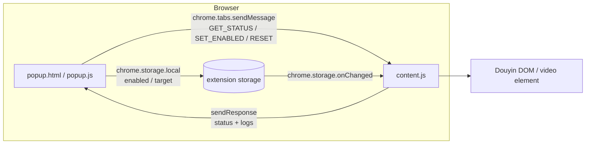
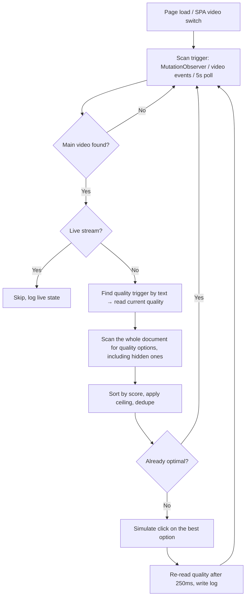

<div align="center">

# Douyin Web · Auto Highest Quality

**Open a video and it switches to the best available resolution automatically — no more clicking "Quality" every time.**

A minimal-permission Chrome / Edge extension built on Manifest V3.

[简体中文](README.md) · [English](README_EN.md)

[](https://github.com/ShirakawaFM/douyin-auto-hd/releases)
[](LICENSE)
[](manifest.json)
[](https://github.com/ShirakawaFM/douyin-auto-hd)
[](https://github.com/ShirakawaFM/douyin-auto-hd)
[](https://github.com/ShirakawaFM/douyin-auto-hd/stargazers)

</div>

> ⚠️ **Unofficial project**: not affiliated with, endorsed by, or authorized by Douyin / ByteDance.
> It exists for learning about browser-extension automation. You are responsible for complying with the
> platform's Terms of Service and your local laws.

---

## Table of contents

- [Overview](#overview)
- [Features](#features)
- [Installation](#installation)
- [Usage](#usage)
- [How it works](#how-it-works)
- [Permissions & privacy](#permissions--privacy)
- [Compatibility & known limitations](#compatibility--known-limitations)
- [FAQ](#faq)
- [Development & debugging](#development--debugging)
- [Roadmap](#roadmap)
- [Contributing](#contributing)
- [License & disclaimer](#license--disclaimer)

---

## Overview

The Douyin web player picks a default quality based on your network, login state and the video source.
To watch a sharper version you normally have to:

1. move the mouse to the bottom-right corner of the player;
2. wait for the control bar to appear;
3. open the "Quality" (清晰度) menu;
4. find the highest option and click it.

Worse, Douyin is a SPA: **every video switch can reset the quality to the default**, so those four steps
repeat forever.

This extension automates the loop: detect the video → read the current quality → enumerate all available
quality options → pick the highest one → simulate a click → read the quality again and write a log entry.
It does **not** modify network requests, inject remote code, or bypass paywalls / membership limits. It simply
clicks what you would have clicked.

## Features

| Feature | Description |
| --- | --- |
| **Auto highest quality** | Recognizes `4K / 2160P / 臻彩 / 2K / Blu-ray / 1080P / 720P / 540P / 480P / 360P`; defaults to the highest available option |
| **Quality ceiling** | Prefer a cap? Choose `Max / 4K / 2K / 1080P / 720P / 540P` in the popup; the extension picks the highest option at or below that level |
| **Manual downgrade confirmation** | If you manually pick a lower quality, the extension intercepts and asks first, so it never fights you |
| **"Always keep highest" lock** | Once chosen, every manual downgrade in the current session is blocked (resets on page refresh) |
| **Live-stream skip** | Detects live streams (`live.douyin.com`, `/live/` paths, abnormal duration) and skips all quality logic |
| **SPA aware** | No `DOMContentLoaded` dependency; `MutationObserver` + `<video>` events + a 5-second poll track video switches |
| **No hard-coded class names** | Quality options are found by visible text and leaf-node filtering, not by CSS classes |
| **Minimal permissions** | Only `storage`, `activeTab` and host access to Douyin; **no** `tabs`, no `<all_urls>`, no background worker |
| **Dark popup UI** | Glassmorphism-style popup with toggle, quality dropdown, switch log, reset button and subtle animations |
| **Debuggable** | Console output prefixed with `[抖音HD]` shows candidate options and raw menu texts |

## Installation

### Requirements

- **Chrome 88+** or **Edge 88+** on Windows / macOS / Linux (Manifest V3 baseline)
- Not published to the Chrome Web Store / Edge Add-ons yet, so install it as an **unpacked extension**

### Chrome

1. Download this repository (`Code → Download ZIP` and unzip, or `git clone`);
2. Open `chrome://extensions/`;
3. Enable **Developer mode** (top right);
4. Click **Load unpacked**;
5. Select the folder that contains `manifest.json` (i.e. `douyin-auto-hd/`);
6. Open — or **reload** — any video page on `https://www.douyin.com/`.

### Edge

1. Open `edge://extensions/`;
2. Enable **Developer mode** (left sidebar);
3. Click **Load unpacked**;
4. Select the folder that contains `manifest.json`;
5. Reload any open Douyin tab.

> **Nothing happens after installing?** Reload the Douyin page first — content scripts are injected at page
> load, so tabs opened before installation never receive the script.

## Usage

Click the toolbar icon to open a 352px dark popup with three sections:

### 1. Auto quality toggle

- On: videos are switched to the configured target quality automatically;
- Off: all automatic behavior stops (manual-downgrade interception stops too);
- The state is stored in `chrome.storage.local` and synced across tabs.

### 2. Target quality

Options: `Max (default)`, `4K`, `2K/1440P`, `1080P`, `720P`, `SD (540P)`.

The extension switches to the **highest available option at or below** the selected level. For example, with
`1080P` selected it will not jump to 4K even if 4K exists. Changing the value clears internal caches and
re-evaluates immediately.

### 3. Switch log

- Shows the latest 50 entries (in memory only — cleared on page refresh);
- The first (highlighted) item is the newest, e.g. `自动切换至最高画质：1080P`;
- **Reset** clears the log, clears caches and triggers a rescan.

### Status hints

An amber banner explains common problems:

| Hint | Meaning / fix |
| --- | --- |
| `非抖音页面：请在抖音网页版打开此弹窗` | The active tab is not a Douyin page; the extension does not run there |
| `内容脚本未响应：请刷新抖音页面后重新打开弹窗` | The tab predates installation/update — reload the page |

### Manual downgrades and the lock

If you open the quality menu yourself and pick something **lower than the known best**:

- A dialog appears: **确定** (allow low quality for this video only) or **始终保持最高画质** (lock the
  highest quality for this session);
- Choosing the first option disables the lock for the **current video only**; it is restored on the next video;
- Choosing the lock blocks every manual downgrade until the page is refreshed;
- The extension's own automatic clicks never trigger this dialog (an internal `suppressIntercept` flag).

### Live streams

Live streams are detected and skipped entirely; the log records `识别到直播，跳过画质逻辑` and playback is left
untouched.

## How it works

### Components and data flow

There is no background service worker. Only two contexts exist: the **content script** injected into Douyin
pages, and the **popup** opened when you click the icon.



- **content script**: injected only on `https://*.douyin.com/*`; detects playback, clicks quality options,
  keeps the log;
- **popup**: only edits configuration and renders logs; it never touches the page directly;
- **storage**: the single source of truth is `chrome.storage.local` key `douyinAutoHDConfig`
  = `{ enabled: boolean, target: string }`.

### Automatic switching flow



A full pass (`switchIfNeeded`) is roughly:

1. **Throttle** — return if less than 500 ms since the last attempt;
2. **Pick the main video** — score every `<video>` by resolution area, playing state, `readyState` and
   visibility to avoid hidden previews/ads;
3. **Live detection** — `live.douyin.com`, a `/live/` path, or `duration > 43200` seconds means live;
4. **SPA detection** — a change in `video.src / currentSrc` clears caches (`knownBest`, temporary lock,
   failure streak) and rebuilds the `MutationObserver`;
5. **Read current quality** — prefer buttons whose text contains `清晰度 / 画质 / 智能 / 自动`; otherwise fall
   back to a short quality label (`labelOf` reads only direct text, never aggregated parent text);
6. **Enumerate options** — `findAllQualityOptions()` scans the whole document **without a visibility filter**
   (Douyin keeps options in the DOM and merely hides them), excluding the trigger itself and parents whose
   children already match;
7. **Score and select** — apply `QUALITY_RULES`, filter by the configured ceiling, dedupe by label, take max;
8. **Click** — `findClickableUp` finds the real clickable ancestor, then `safeClick` dispatches
   `pointerdown / mousedown / pointerup / mouseup / click` while setting `suppressIntercept`;
9. **Verify** — 250 ms later the trigger text is read again into `currentQuality` and the log; failures do not
   throw, they are throttled and retried.

### Quality rules

All matching normalizes text first (uppercase, whitespace removed) and uses **fully anchored** regexes, so
titles such as `超高清视频怎么制作` are never mistaken for quality options.

| Score | Label | Anchored regex |
| ---: | --- | --- |
| 4000 | 4K | `^(4K\|超清4K)$` |
| 2160 | 2160P | `^2160P$` |
| 1500 | 臻彩 (Zhencai) | `^臻彩$` |
| 1440 | 2K | `^(2K\|超清2K)$` |
| 1200 | 蓝光 (Blu-ray) | `^蓝光$` |
| 1080 | 1080P | `^(1080P\|高清1080P\|超清)$` |
| 720 | 720P | `^(720P\|高清720P\|高清)$` |
| 540 | 540P | `^(540P\|标清540P\|标清)$` |
| 480 | 480P | `^480P$` |
| 360 | 360P | `^(360P\|流畅)$` |

> 4K scores 4000 on purpose: when both 4K and 2160P labels exist for the same stream, 4K wins.

Ceiling mapping (`targetCeilingScore`): `max → unlimited`, `4k → 4000`, `2k → 1440`, `1080p → 1080`,
`720p → 720`, `540p → 540`.

### Implementation notes

- **SPA handling**: no `DOMContentLoaded` listener; `MutationObserver` watches `document.body` with
  `childList + subtree` (portal-mounted quality popovers included) and debounces scans by 600 ms. `<video>`
  events (`loadedmetadata / canplay / play / durationchange / emptied`) trigger a fast rescan after 80 ms.
- **Clicking hidden options**: Douyin keeps quality items in the DOM and only hides them, so the extension
  clicks them directly instead of first hovering to reveal the control bar — this removes the hover dependency.
- **Anchored text matching** (v2.4.3): fixed a bug where a title containing "4K"/"超清" could be clicked,
  navigating to search results.
- **No synthetic mouse moves** (v2.4.3): removed the `revealControls` mousemove/mouseover simulation that
  conflicted with seeking (the "jitter/rewind" bug).
- **Manual downgrade interception**: a capture-phase `click` listener on `document`, earlier than React's
  delegated handler; it only intercepts when the menu is really open (≥ 2 visible quality options) and the
  clicked score is below `knownBest`.
- **Resilience**: 500 ms scan throttle, failure streak with an ad-blocker hint after 3 misses, global
  `try/catch`, `window.onerror` and `unhandledrejection` guards so the popup never hangs.
- **Logging**: in-memory ring buffer capped at 50 entries, deliberately not persisted.

### Project layout

```text
douyin-auto-hd/
├── manifest.json          # MV3 manifest: permissions, content-script matches, popup entry
├── content.js             # Core content script (detect / switch / intercept / log)
├── popup.html             # Popup markup (toggle, quality selector, log)
├── popup.css              # Popup styles (dark theme, glassmorphism, animations)
├── popup.js               # Popup logic (config, messaging, log rendering)
├── README.md              # Chinese documentation
├── README_EN.md           # English documentation (this file)
├── CHANGELOG.md           # Version history
├── CONTRIBUTING.md        # Contribution guide
├── LICENSE                # MIT
├── .github/               # Issue/PR templates and Actions (validation + release packaging)
└── docs/
    └── PUBLISHING.md      # Release & maintenance manual (with troubleshooting)
```

## Permissions & privacy

### Permission list

| Permission | Purpose | Required |
| --- | --- | --- |
| `storage` | Persist the toggle and quality ceiling | Yes |
| `activeTab` | Read the active tab URL when the popup opens, to tell whether it is a Douyin page | Kept for this purpose |
| `host_permissions: https://*.douyin.com/*`<br>`host_permissions: https://douyin.com/*` | Restrict content-script injection to Douyin domains | Yes |

**Deliberately not requested**

- ❌ `tabs` — no need to read all tabs;
- ❌ `<all_urls>` — never touches non-Douyin sites;
- ❌ background service worker — nothing runs persistently;
- ❌ `webRequest` / `declarativeNetRequest` — no request inspection or modification;
- ❌ remote code / `eval` — no remote scripts, no dynamic code evaluation.

### Privacy

- **No data collection**: no analytics, no telemetry, no account data;
- **No network requests**: neither `content.js` nor `popup.js` uses `fetch` / `XMLHttpRequest` / WebSocket;
- **One local setting only**: `douyinAutoHDConfig = { enabled, target }` in `chrome.storage.local`;
- **Logs stay in memory** (max 50 entries, lost on refresh);
- **Read-only DOM + synthetic clicks**: no clipboard, camera, microphone or other sensitive capabilities.

## Compatibility & known limitations

### Compatibility

| Browser | Version | Status |
| --- | --- | --- |
| Chrome / Chromium-based browsers | 88+ | ✅ Primary target (Manifest V3 baseline) |
| Microsoft Edge | 88+ | ✅ Supported (same engine) |
| Firefox | — | ❌ Not adapted (MV3 API/permission differences) |
| Mobile browsers | — | ❌ Extensions unsupported |

### Known limitations

1. **Depends on Chinese UI text** — quality detection is purely text-based, and Douyin's DOM/wording changes
   often. If the menu becomes icon-only or wording changes, detection breaks until `QUALITY_RULES` and
   `findQualityTrigger` in `content.js` are updated.
2. **Heuristic Chinese quality ranking** — `臻彩 > 蓝光 > 超清 > 高清 > 标清 > 流畅` is empirical; per-video
   availability differs and may need score recalibration.
3. **Possible false positives** — matching is not strictly scoped to the player container; leaf-node and
   short-text filters reduce but cannot eliminate the risk.
4. **Depends on menu interaction** — currently clicks hidden options already present in the DOM; hover-only
   menus, confirmation steps or asynchronously loaded options could break it.
5. **Cannot bypass platform limits** — higher tiers may require login or membership; the extension can only
   pick the best option the page actually exposes.
6. **Live detection is heuristic** — domain/path/duration based, not exhaustive.
7. **Current quality is inferred** — read from button text; no stable public API exists.
8. **Logs are not persisted** — intentional lightweight trade-off.
9. **Not published to a store** — manual load only, **no auto-update**; updates require re-download + reload.
10. **Ad blockers may interfere** — DOM rewrites can break detection; whitelist `douyin.com` if needed.

## FAQ

<details>
<summary><b>Nothing happens after installation?</b></summary>

1. Did you **reload** the Douyin tab? Tabs opened before installation never receive the content script;
2. Is the extension enabled and free of errors in `chrome://extensions/`?
3. Did you select the folder that contains `manifest.json`?
4. Is an ad blocker rewriting the DOM? Try whitelisting `douyin.com`;
5. Open the popup and check for `内容脚本未响应`.

</details>

<details>
<summary><b>The popup says "not a Douyin page"?</b></summary>

The active tab is not on `douyin.com` (or a subdomain). The extension intentionally runs nowhere else.

</details>

<details>
<summary><b>Quality did not improve?</b></summary>

1. The video may simply not offer a higher tier (a 720P source cannot become 4K);
2. Higher tiers may require login or membership; the extension cannot create options the page does not expose;
3. Check the popup log: `自动切换至最高画质：XXX` means the click happened;
4. `连续多次未识别到画质菜单` usually means an ad blocker or a Douyin redesign.

</details>

<details>
<summary><b>Why does it re-detect after every video switch?</b></summary>

Douyin is an SPA: the `<video>` element is reused and quality state resets. The extension watches `src`
changes and `<video>` events, clears caches and rescans on every switch.

</details>

<details>
<summary><b>It switched back to low quality on its own?</b></summary>

Douyin sometimes resets the tier while buffering. The 5-second poll switches back to the best known option;
pick **始终保持最高画质** in the downgrade dialog for a stronger lock.

</details>

<details>
<summary><b>Can this get my account flagged?</b></summary>

It only reads page text and dispatches synthetic clicks — no request tampering, no API forgery, no paywall
bypass. Behavior matches a manual click, but any automation carries platform-policy risk; use at your own
discretion.

</details>

<details>
<summary><b>Why is it not on the Chrome Web Store?</b></summary>

Store listing requires icons, screenshots, a privacy statement and review. The project is distributed as
source with manual installation; see [CONTRIBUTING.md](CONTRIBUTING.md) if you want to help prepare store assets.

</details>

<details>
<summary><b>How do I update?</b></summary>

`git pull` (or re-download and overwrite), click **Reload** on the extension card in
`chrome://extensions/`, then refresh the Douyin tab.

</details>

## Development & debugging

### Load and reload

1. `chrome://extensions/` → Developer mode → **Load unpacked** → pick the project root;
2. After editing `content.js`, click **Reload** on the card, then refresh the Douyin tab;
3. After editing `popup.*`, just close and reopen the popup (some style changes need a full reload).

### Debug logging

- The page console (`F12 → Console`) prints `[抖音HD]` scans: video size, live flag, current quality, option
  count, candidate list and raw menu texts (`qualityTexts`);
- Toggle verbosity with `const DEBUG = true;` at the top of `content.js`;
- Popup debugging: right-click the popup → **Inspect**.

### Inspecting storage

There is no background worker; inspect `douyinAutoHDConfig` from the popup's DevTools → Application → Storage
→ Extension storage.

### Release process

1. Bump `version` in `manifest.json`;
2. Add a `CHANGELOG.md` entry;
3. Commit, then `git tag -a v2.4.4 -m "v2.4.4"` and `git push origin v2.4.4`;
4. GitHub Actions verifies that the tag matches the manifest version and attaches
   `douyin-auto-hd-v<version>.zip` to the release (see `.github/workflows/release.yml`).

> Manual packaging: zip `manifest.json`, `content.js`, `popup.html`, `popup.css`, `popup.js` — exclude `.git`,
> `docs/` and `node_modules/`.

## Roadmap

- [ ] **Scope scans to the player container** to cut false positives and cost
- [ ] **Use `TreeWalker` / incremental scanning** instead of `querySelectorAll('*')`
- [ ] **Read real resolution** via `getVideoPlaybackQuality()` when available
- [ ] **Fallback triggers** (settings icon, speed button) for version compatibility
- [ ] **Persist and export logs**
- [ ] **Configurable quality priority**
- [ ] **Graceful retry** after repeated failures
- [ ] **Internationalization** (English UI and wording)
- [ ] **Icons and store assets** (16/32/48/128 PNG, screenshots, privacy statement)
- [ ] **Automated tests** for the quality-matching rules

## Contributing

Issues and pull requests are welcome. Please read [CONTRIBUTING.md](CONTRIBUTING.md) first — it covers the
information needed for bug reports, the code style, Conventional Commits and the PR checklist (no new
permissions, test on Chrome + Edge, update CHANGELOG).

When reporting "quality not detected on some video", attach the `[抖音HD] scan` console output, especially
`qualityTexts` — it speeds up diagnosis a lot.

## License & disclaimer

Released under the [MIT License](LICENSE), Copyright (c) 2026 ShirakawaFM.

- Free to use, modify and redistribute, including commercially, provided the copyright notice and license are kept;
- Provided **as is**, without warranty of any kind;
- Not affiliated with or endorsed by Douyin / ByteDance;
- Comply with the target platform's Terms of Service and local laws; you are responsible for your use;
- If the platform believes this project is problematic, please open an issue and it will be handled promptly.

---

<div align="center">

If this project saves you clicks every day, a ⭐ Star is appreciated.

[Changelog](CHANGELOG.md) · [Contributing](CONTRIBUTING.md) · [Publishing guide](docs/PUBLISHING.md)

</div>
